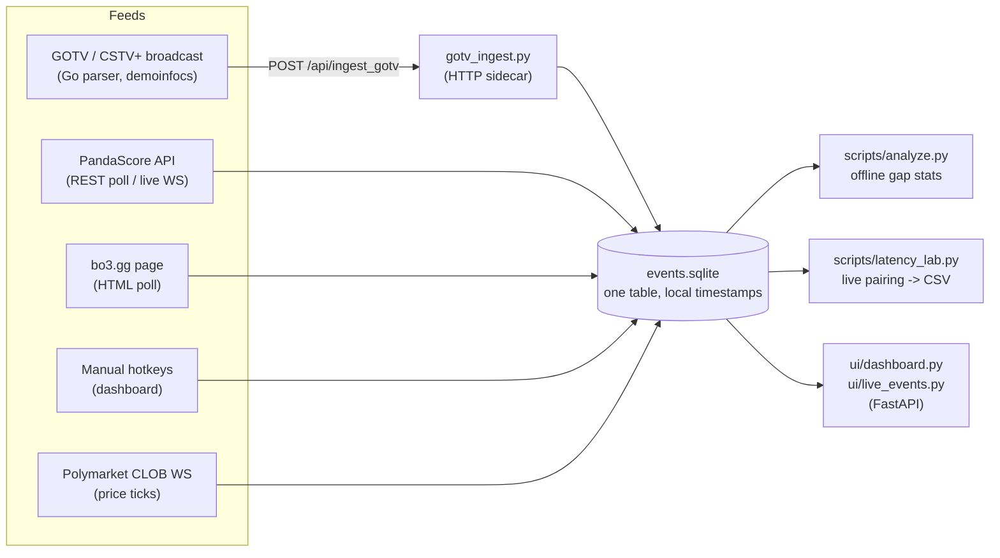

# cs2-polymarket-latency-lab

[](https://github.com/gtsmmst/cs2-polymarket-latency-lab/actions/workflows/tests.yml)

A small measurement rig for one question: **how early do CS2 match events (round ends,
map ends, bomb plants) reach Polymarket prices compared with the feeds I can get my hands
on?**

It is **not a trading bot**. There is no order placement anywhere in this repository
(`place_bet` raises `NotImplementedError` on purpose). Everything is read-only: feeds in,
timestamps into SQLite, statistics out.

Built May–June 2026 as an unfinished side project, with AI assistance (Claude) for most
of the code. Published as-is for portfolio purposes; see **Findings** and **Status**
before reading anything else into it.

---

## Idea

Twitch streams of CS2 matches run 60–90 s behind the game. Polymarket match-winner
prices visibly move a few seconds after a round ends, so whoever moves them has a
faster source than the stream. The lab records every candidate feed and the market
with **one local clock** and measures the gaps:

- **GOTV / CSTV+** – the game's own broadcast protocol, parsed with
  [demoinfocs-golang](https://github.com/markus-wa/demoinfocs-golang) (Go).
- **PandaScore** – esports data API (REST polling on the free tier; a live socket on
  paid tiers).
- **bo3.gg** – page polling, as a coarse independent reference.
- **Manual hotkeys** – press a key when you see the event on the stream; gives the
  "stream lag" baseline.
- **Polymarket CLOB WebSocket** – every `price_change` / `best_bid_ask` /
  `last_trade_price` tick for the match's tokens.

Because every event is stamped with `received_ts_ms` from the same machine, deltas
between sources need no clock synchronisation with any upstream server.

## Architecture



Every watcher writes to the same `events` table (`watchers/_db.py`):

| column           | meaning                                                        |
|------------------|----------------------------------------------------------------|
| `received_ts_ms` | local wall clock when the message reached this machine         |
| `source_ts_ms`   | upstream timestamp if the feed provides one                    |
| `source`         | `gotv` / `panda` / `bo3` / `manual` / `poly`                    |
| `kind`           | `round_end`, `kill`, `map_score`, `price_change`, …              |
| `match_id`, `asset_id`, `market_id`, `round_num`, `payload` | identifiers + raw JSON |

## Repository layout

```
watchers/
  _db.py               shared SQLite writer + schema (thread-safe)
  poly_ws_watcher.py   Polymarket CLOB WebSocket -> bus
  gotv_ingest.py       HTTP sidecar receiving events from the Go parser -> bus
  gotv/                Go: CSTV+ broadcast parser (demoinfocs-golang v5)
  panda_cs2_watcher.py PandaScore REST poll (map-level) / live WS (paid) -> bus
  bo3_poller.py        bo3.gg page snapshots -> bus
  polymarket_feed.py   in-process Polymarket WS client + Gamma API market lookup
  demo_feed.py         synthetic match-state generator (standalone fixture, unused)
ui/
  dashboard.py         hotkey markers, live tail, gap table, tick rate, CSV export
  live_events.py       scrolling event feed + active matches
scripts/
  init_db.py           create the database
  analyze.py           offline gap statistics (median / p95 per source and kind)
  latency_lab.py       live pairing: game event -> next price_change, CSV + summary
  find_market.py       Polymarket URL/slug -> asset ids
  find_match.py        HLTV / bo3.gg URL -> match id / slug
tests/                 pytest, no network
```

## Setup

Python 3.10+ and (for the GOTV parser) Go 1.24+.

```bash
python -m venv .venv && source .venv/bin/activate     # Windows: .venv\Scripts\Activate.ps1
pip install -r requirements.txt
cp .env.example .env                                   # fill in PANDASCORE_TOKEN if you use PandaScore
python -m scripts.init_db                              # creates data/events.sqlite
```

Go parser:

```bash
cd watchers/gotv
go mod download
go build -o gotv_watcher .
```

### Configuration

Everything is environment variables; nothing is read from files in the repo.

| variable           | used by                        | notes                                      |
|--------------------|--------------------------------|--------------------------------------------|
| `PANDASCORE_TOKEN` | `watchers/panda_cs2_watcher`   | required for that watcher only; never logged |
| `LATENCY_LAB_DB`   | everything                     | path to the SQLite bus; default `data/events.sqlite` |

`.env.example` lists them. No automatic `.env` loading: `set -a; source .env; set +a`
on bash, or `$env:PANDASCORE_TOKEN = "..."` in PowerShell.

## Running the pipeline

Each component is a separate process; run the ones you want in separate terminals from
the repository root. All of them create the database schema on first use.

**1. Polymarket prices** – find the match's token ids, then subscribe:

```bash
python -m scripts.find_market "https://polymarket.com/esports/cs2/<tournament>/cs2-<a>-<b>-<date>"
python -m watchers.poly_ws_watcher --assets <asset_id_1>,<asset_id_2>
```

**2a. GOTV** – you need a CSTV+ broadcast URL (the kind you would pass to `playcast`
in the CS2 console). Start the sidecar, then the parser:

```bash
python -m watchers.gotv_ingest
cd watchers/gotv && ./gotv_watcher -url "https://<cstv-host>/<broadcast>" -match <id> -v
```

**2b. PandaScore** – map-level score changes on the free tier:

```bash
export PANDASCORE_TOKEN=...            # or set it in your shell profile
python -m watchers.panda_cs2_watcher --interval 5 --leagues "IEM,BLAST,ESL Pro,Major"
```

**2c. bo3.gg** – page snapshots, as a coarse reference:

```bash
python -m scripts.find_match "https://bo3.gg/matches/<slug>"
python -m watchers.bo3_poller --match-slug <slug>
```

**3. Dashboards**

```bash
python -m ui.dashboard       # http://localhost:8765 – hotkeys K/B/D/R/P/W/L/E, gap table, tick rate
python -m ui.live_events     # http://localhost:8767 – scrolling event feed
```

**4. Analysis**

```bash
python -m scripts.analyze                              # gotv -> first following poly tick
python -m scripts.analyze --source gotv --source manual --since "2026-06-09 12:00" --csv gaps.csv
python -m scripts.latency_lab --asset-ids <tok_a>,<tok_b> --team-a A --team-b B   # live pairing
```

`analyze.py` pairs each game event with the **first following** Polymarket tick within a
window (default 30 s). The dashboards use the **nearest** tick instead and allow negative
gaps for automated sources, so a negative median there reads as "the market moved
before the feed delivered the event".

### Tests

```bash
pip install -r requirements-dev.txt
pytest
```

The tests build a temporary SQLite bus with the real schema and writer, insert events
with known offsets, and check the gap statistics and the live pairing logic. No network.

## Findings

Plainly, from the sessions in June 2026:

- **Public GOTV lags the stream.** The public CSTV+ relay I could reach was buffered by
  the broadcaster and delivered events *later* than the Twitch stream, not earlier.
  No edge from it. The parser works; the source is slow.
- **PandaScore live socket was never evaluated.** The free tier gives map-level scores
  with a few seconds of delay (works, recorded) but the per-event WebSocket returns a
  permission error without a paid plan, which was not purchased. The `--ws` mode is
  untested plumbing.
- **Polymarket side works well.** The CLOB WebSocket is a reliable, fast source of
  price ticks, and the bus/dashboard make it easy to see when the book moves.
- **The pipeline is a prototype.** Measurement works end to end; the "edge" part was
  never validated. Nothing in this repository was shown to be profitable, and nothing
  here places orders.

## Status

Unfinished, archived. Working: Polymarket watcher, SQLite bus, Go GOTV parser + ingest
sidecar, PandaScore poll mode, bo3.gg poller, both dashboards, offline analysis,
tests. Untested: PandaScore live socket mode (needs a paid plan).

Things I would do next if I picked it up again:

- Get a genuinely low-latency game feed (paid tier or tournament data partner) and
  re-run the same measurement.
- Replace polling in `latency_lab.py` with a change notification on the bus.
- Share the gap computation between `scripts/analyze.py` and the two dashboards
  (they implement two slightly different definitions on purpose, but the plumbing is
  duplicated).
- Per-asset pairing in `analyze.py` (currently any Polymarket tick counts, not only
  the winner's token).

## License

MIT, see `LICENSE`.
